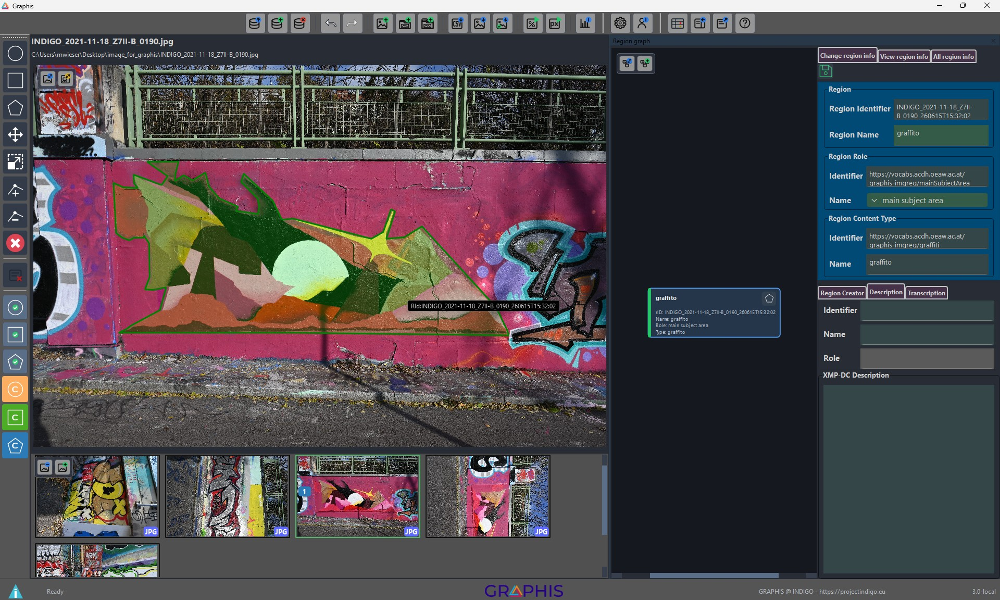

## Table of contents
* [General info](#general-info)
* [Install](#install)
* [Usage](#usage)
* [AI models](#ai-models)


## General info
Since its [2019.1 version](https://www.iptc.org/std/photometadata/specification/IPTC-PhotoMetadata-2019.1.html), the IPTC Photo Metadata Standard has facilitated the creation of image regions: groupings of image pixels—defined by a circle, rectangle, or any other polygonal shape—which can be annotated with region-specific metadata.

GRAPHIS (<ins>G</ins>enerate <ins>R</ins>egions and <ins>A</ins>nnotations for <ins>PH</ins>otos using the <ins>I</ins>PTC <ins>S</ins>tandard) is an open-source and freely available Windows-based software to create or change IPTC image regions, annotate them with graffiti descriptions or transcriptions, and visualise them. The backend of GRAPHIS is programmed in [Python 3](https://www.python.org), while PySide—also known as [Qt for Python](https://wiki.qt.io/Qt_for_Python)—was used for the Graphical User Interface (GUI). In addition, GRAPHIS relies on many other pieces of software, of which the most prominent ones function as interfaces for data handling: [IPTC-IRIS](https://github.com/GraffitiProjectINDIGO/iptc-iris) to normalise, validate, and write the IPTC image regions, [ExifTool](https://exiftool.org) to read and write photo metadata, the Python wrapper [rawpy](https://pypi.org/project/rawpy) for [LibRaw](https://www.libraw.org) to read the primary image pixels of RAW photo files, and the database engine [SQLite](https://www.sqlite.org) for intermediate data storage. Thanks to GRAPHIS' GUI, one does not need to know and understand how these separate software components operate. Finally, the [GRAPHIS Image Region vocabulary](https://vocabs.acdh.oeaw.ac.at/graphis-imgreg) provides GRAPHIS with a controlled list of concepts defined explicitly for graffiti image regions.

GRAPHIS supports the most common raster image file formats that store IPTC metadata: JPEG, TIFF, PNG, and many RAW formats. The metadata of all imported images are read and written into a local SQLite database; this database also stores each operation on the image regions. GRAPHIS can store the (newly created or altered) image regions and their annotations back into the original images at any time, but only if chosen so in the menu.

## Install
The latest release of GRAPHIS can be found at [github](https://github.com/GraffitiProjectINDIGO/GRAPHIS).

### From Source
To install GRAPHIS you can execute in the graphis directory (same one where you found this file after cloning the git repo):

```
  pip install .
```

## Builds
The latest compiled release (ready as executable on a Windows machine) can be found [here](https://github.com/GraffitiProjectINDIGO/GRAPHIS/releases).

### Build executable
One can also run ```pyinstaller Graphis_pyinstaller.spec``` to create an executable software package graphis_XX.
For this you need the pyinstaller installed in your environment.

### Qt6 and PySide6
If you want to build Qt6 and PySide6 from source, the source code and build instructions for PySide6 and Qt6 can be found under ``source``.
You can also find more in detail information at [Qt for Python](https://wiki.qt.io/Qt_for_Python)

### LibRAW
If you want to build LibRAW from source, the source code and build instructions be found under ``source``.


## Dependencies

### Python
GRAPHIS runs on **Python 3.11+**.
GRAPHIS has been tested on Windows.

### Packages
It relies only on well-developed packages
- [numpy](https://www.numpy.org)
- [PySide6](https://doc.qt.io/qtforpython-6) under the GPLv3. The source code and build instructions for Pyside6 and Qt6 can be found under ``source``.
- [shapely](https://shapely.readthedocs.io/en/stable/index.html)
- [Pillow](https://python-pillow.org/)
- [LibRaw](https://www.libraw.org/) under the LGPLv2.1 using [rawpy](https://pypi.org/project/rawpy). The source code for LibRAW can be found under ``source``.

and the package [PyExiftool](https://github.com/sylikc/pyexiftool) as interface to EXIFTool's command line

## Cite
**Much more information can be found in the following publication, which users of GRAPHIS are also asked to cite:<br>
Verhoeven, G.J., Wieser, M., Carloni, M., 2024. <i>GRAPHIS—Visualise, Draw, Annotate, and Save Image Regions in Graffiti Photos</i>, in: <ins>disseminate | analyse | understand graffiti-scapes. Proceedings of the goINDIGO2023 international graffiti symposium</ins>, Vienna, Austria. 14-16 June 2023. Urban Creativity, Lisbon, pp. 72-103. DOI: [10.48619/indigo.v0i0.977](https://doi.org/10.48619/indigo.v0i0.977).**


## Usage
GRAPHIS aims to add, manipulate, or visualise IPTC image regions. All shapes must lie within the image, and polygons must be valid (for example, without self-intersections). Additional meta information can be stored for each image region.

Circles, rectangles, and polygons follow the published IPTC Photo Metadata Standard 2025.1. In addition, GRAPHIS supports the extended image regions planned for the next version of the IPTC Photo Metadata Standard: polygons with holes, multi-polygons, points, lines, grouped regions, and a depth order. This support is **experimental** until that version is published; software that only implements 2025.1 may ignore such regions or display them incorrectly.

To create or alter an image region, the user should select one of the region operators with a left mouse click. With the circle and rectangle tools, drawing starts and ends with a right mouse click. Polygons are finished with a left click because every right click of the mouse creates a new vertex. Upon finishing the creation of a shape, its region boundary information gets automatically stored in the SQLite database, while the image region property gets default values that are defined in the graphis.config file (a text-based configuration file). Any change in geometry is immediately submitted to the underlying SQLite database, while metadata changes must be submitted with the green floppy disk icon.

When drawing a region, the last-used drawing tool remains active (indicated by its yellow icon), allowing the user to keep drawing with the same tool without activating it every time. Suppose metadata properties need to be added (like a description) or changed (like the region name) after drawing that region. In that case, the user can quickly save that new information with CTRL+S, avoiding a mouse click on the saving icon. The Enter and Backspace buttons allow navigation to the next or previous image. However, this will only work if the cursor is not on a metadata field, as one would otherwise start typing in that field. These features support the rapid creation of polygons with minimal mouse clicks. GRAPHIS also ensures that a region cannot be finalised if it partly lies outside the image boundaries. In addition, intersecting polygon edges are not allowed.

Once an image region has been created, it is possible to modify its shape in various ways using some of the tools provided by GRAPHIS. For example, circles and rectangles can be resized, while the same tool can also be used to move polygon vertices. Other tools allow the user to shift or delete the entire shape, or to add or remove individual polygon vertices. As with the drawing tools, a left mouse click activates these shape modification tools, while a right mouse click executes the action.

While currently only fixed metadata fields of the image region can be edited, all meta-information about the image regions can be shown with the tabs on the right side. The "View region info" tab displays all the properties of the selected region. The "All region info" tab lists all properties of every image region in the active image. In the last two tabs, properties can be expanded or collapsed at will.

Results can be saved directly inside the images or in a separate CSV file. Altering image regions outside of GRAPHIS while the SQLite database still holds image region metadata that are not written back into the image file will lead to errors.




## AI models
GRAPHIS can segment image regions with AI (SAM models) and transcribe dictated descriptions and transcriptions
(speech recognition). GRAPHIS does not ship any AI models. Speech models, MobileSAM and SAM2 can be downloaded
from within GRAPHIS; SAM3 and TextureSAM are downloaded manually as described below.
Select the model folders with the **AI configuration** button (gear
with "AI") in the top toolbar. The configuration shows which models were found.

### Python packages
When running from source, install the optional dependencies:

```
  pip install ".[ai]"        # image segmentation (PyTorch, Ultralytics)
  pip install ".[speech]"    # speech recognition (faster-whisper, runs on CPU)
```

For an NVIDIA GPU, install the CUDA build of PyTorch; for an AMD GPU on Linux, the ROCm build. Follow the
selector on [pytorch.org](https://pytorch.org/get-started/locally/). Without a supported GPU, segmentation runs on
CPU. More details: [doc/ai-devices.md](doc/ai-devices.md).

### Segmentation models
All segmentation model files are stored directly in one folder, the segmentation folder.

**MobileSAM and SAM2** can be downloaded from within GRAPHIS: click **Download...** in the segmentation row of the
AI configuration, choose a download folder (default: a `models/segmentation` folder in the GRAPHIS configuration
folder), select the model and click **Download**. The download folder becomes the segmentation folder
automatically. MobileSAM is recommended without an NVIDIA GPU; SAM2 is more accurate but slower.
Direct links: [mobile_sam.pt](https://github.com/ultralytics/assets/releases/download/v8.4.0/mobile_sam.pt),
[sam2.1_l.pt](https://github.com/ultralytics/assets/releases/download/v8.4.0/sam2.1_l.pt).

**SAM3** (best results; slow without an NVIDIA GPU; 3.4 GB) is provided by Meta on Hugging Face and requires a free
account and Meta's approval:

1. Create an account at [huggingface.co](https://huggingface.co/join) and sign in.
2. Open [facebook/sam3](https://huggingface.co/facebook/sam3), fill in the access form and wait until access is
   granted (you get an e-mail; this can take a while).
3. On the model page, open **Files and versions** and download `sam3.pt`.
4. Put `sam3.pt` into the segmentation folder.

**TextureSAM** is a SAM2 model fine-tuned for textures. It needs its source code repository and a checkpoint file:

1. Install the extra Python packages: `pip install ".[texturesam]"`.
2. Get the repository from [GitHub](https://github.com/Scientific-Computing-Lab/TextureSAM), either with
   `git clone https://github.com/Scientific-Computing-Lab/TextureSAM.git` inside the segmentation folder, or with
   **Code > Download ZIP**. The folder must be named `TextureSAM` (rename `TextureSAM-main` after unzipping).
3. Download `sam2.1_hiera_small_1.pt` from the
   [TextureSAM checkpoints on Google Drive](https://drive.google.com/drive/folders/1pUJLa898WYEcb4Y_sOaXsSVe-CsPkwRv?usp=drive_link)
   and put it into the segmentation folder.

The segmentation folder then looks like this (only the models you use are needed):

```
  segmentation/
      mobile_sam.pt
      sam2.1_l.pt
      sam3.pt
      sam2.1_hiera_small_1.pt
      TextureSAM/
          README.md
          sam2/...
```

The AI configuration shows which models were found. Choose the model in the AI toolbox of the image view.

### Speech models
Speech recognition uses [faster-whisper](https://github.com/SYSTRAN/faster-whisper) models (CTranslate2 format,
MIT license). The easiest way to get them is the **Download...** button in the speech window or in the AI
configuration:

1. Choose a download folder (default: a `models/speech` folder in the GRAPHIS configuration folder).
2. Select a model and click **Download**. `small` is recommended: accurate and real-time on most CPUs; `base` is
   faster on slow computers.
3. The model is saved in its own subfolder, e.g. `<download folder>/small`, and the download folder becomes the
   speech model folder automatically.

Manual alternative: put each model in its own subfolder of the speech folder; the subfolder name is the model name
shown in the speech window, and it must contain `model.bin`. For example, with the Hugging Face command line tool
(installed together with faster-whisper):

```
  hf download Systran/faster-whisper-small --local-dir ai-models/speech/small
```

Original OpenAI Whisper `.pt` files do not work.

## Licence
GRAPHIS is licensed under the GPLv3.

Copyright (C) 2026 Martin Wieser, Geert Verhoeven, Indigo Project

This program is free software: you can redistribute it and/or modify it under the terms of the GNU General Public License as published by the Free Software Foundation, either version 3 of the License, or(at your option) any later version.

This program is distributed in the hope that it will be useful, but WITHOUT ANY WARRANTY; without even the implied warranty of MERCHANTABILITY or FITNESS FOR A PARTICULAR PURPOSE.  See the GNU General Public License for more details.

You should have received a copy of the GNU General Public License along with this program.  If not, see <https://www.gnu.org/licenses/>.


See ``LICENSE`` for more details.
